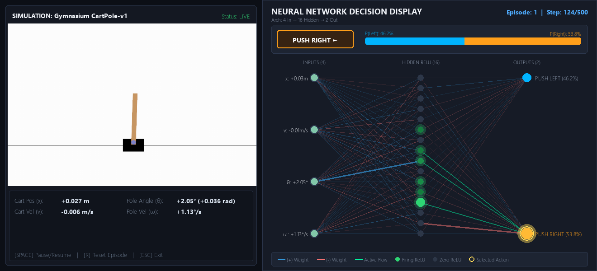

# Neural-Network
 
A small feed-forward neural network built **from scratch in NumPy** (no PyTorch, no TensorFlow), trained to balance a pole on a cart in OpenAI Gym's `CartPole-v1` using a **genetic algorithm**.
 

 
## What's inside
 
| File | Purpose |
| --- | --- |
| `basic_neural_network.py` | The `NeuralNetwork` class: forward pass, mutation, cloning, backpropagation, save/load. |
| `train_cartpole.py` | Evolves a population of networks on CartPole, saves the champion, and can replay it. |
| `network_visualizer.py` | Live "neural decision display" panel shown alongside the CartPole simulation. |
| `cartpole_random.py` | Baseline: runs CartPole with random actions so you can see what "untrained" looks like. |
| `best_cartpole_model.npz` | Pre-trained champion weights (ready to load with `--test-only`). |
| `decision_display_preview.png` | Screenshot of the decision display. |
 
## The network
 
A two-layer fully connected network:
 
```
4 inputs  ->  16 hidden (ReLU)  ->  2 outputs (Softmax)
```
 
- **Inputs:** the 4 CartPole observations (cart position, cart velocity, pole angle, pole angular velocity).
- **Outputs:** probabilities for the 2 actions (push left / push right). The agent takes the `argmax`.
- **Init:** weights ~ `N(0, 0.5²)`, biases at zero.
- Hidden size, mutation rate, and mutation strength are all configurable.
`basic_neural_network.py` also implements full backpropagation (`backward`) with a softmax cross-entropy gradient. The CartPole trainer does not use it; training is purely evolutionary. It's there for supervised learning experiments.
 
## How training works
 
`train_cartpole.py` uses a simple genetic algorithm:
 
1. Create a population of random networks (default 50).
2. Score each one: fitness is the average number of steps the pole stays up over a couple of episodes (max 500).
3. Keep the top 10% unchanged (elitism).
4. Fill the rest of the next generation by cloning parents from the top 40% and **mutating** their weights.
5. Repeat until a network hits the target fitness, or the generation limit is reached.
When a network reaches the target, it is re-tested on 5 fixed seeds. It counts as "solved" if the average is at least 200 steps. The best network is saved to `best_cartpole_model.npz`, followed by a 10-episode generalization check.
 
There is no crossover, only mutation plus selection, which keeps the code short and easy to follow.
 
## Getting started
 
### Requirements
 
- Python 3.9+
- `numpy`
- `gymnasium` with the classic-control extras (for CartPole rendering)
```bash
pip install numpy "gymnasium[classic-control]"
```
 
> The visualizer panel may need additional GUI/plotting libraries depending on how it renders. If `--render` fails on an import, install what the error names, or run with `--no-panel`.
 
### Clone
 
```bash
git clone https://github.com/Vikram-000/Neural-Network.git
cd Neural-Network
```
 
### Watch the pre-trained network
 
```bash
python train_cartpole.py --test-only
```
 
Loads `best_cartpole_model.npz` and renders 5 episodes with the decision panel.
 
### Train your own
 
```bash
python train_cartpole.py --render
```
 
### See the random baseline
 
```bash
python cartpole_random.py
```
 
## Command-line options
 
| Flag | Default | Description |
| --- | --- | --- |
| `--pop-size` | `50` | Number of networks per generation |
| `--hidden-size` | `16` | Neurons in the hidden layer |
| `--generations` | `30` | Maximum number of generations |
| `--target` | `500` | Fitness (steps balanced) at which to stop |
| `--render` | off | Replay the champion after training |
| `--test-only` | off | Skip training; load weights and render |
| `--weights` | `best_cartpole_model.npz` | Path to save/load weights |
| `--no-panel` | off | Use plain Gym rendering instead of the decision panel |
 
Example:
 
```bash
python train_cartpole.py --pop-size 100 --hidden-size 32 --generations 50 --render
```
 
> If you change `--hidden-size` when training, pass the same value with `--test-only` so the saved weights fit the network shape.
 
## Using the network in your own code
 
```python
from basic_neural_network import NeuralNetwork
 
net = NeuralNetwork(input_size=4, hidden_size=16, output_size=2)
net.load("best_cartpole_model.npz")
 
action = net.act([0.0, 0.1, 0.02, -0.1])   # returns 0 or 1
```
 
## Ideas for next steps
 
- Add crossover between parents
- Train with backprop (e.g. imitation of the evolved champion) and compare
- Try other Gym environments (`MountainCar`, `LunarLander`)
- Plot fitness per generation
## License
 
No license has been specified yet. Add one (e.g. MIT) if you want others to reuse the code.